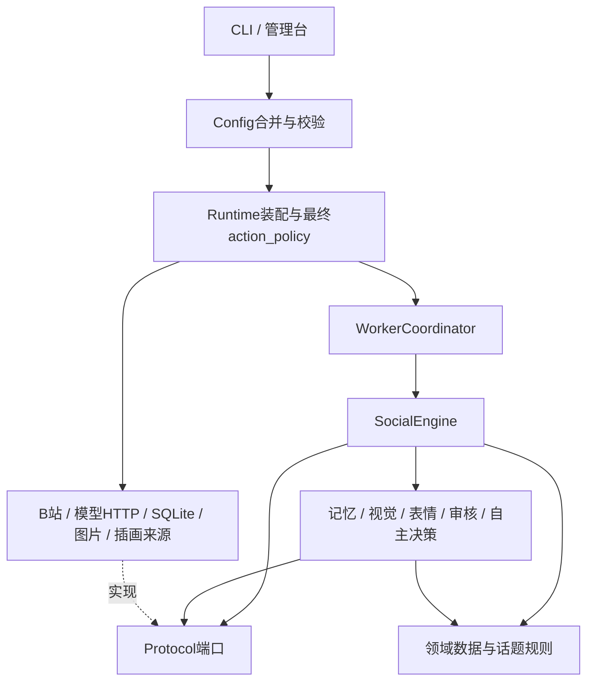

# 当前架构

核对日期：2026-10-29。说明当前工作树中的实现；QQ、微信、X发布和视频投稿不是现有集成。早期设计中按业务拆成多级子目录的树形图是目标设计，以下目录以代码为准。

## 技术栈与运行方式

| 层面 | 当前选择 | 代码依据 |
| --- | --- | --- |
| 语言/包 | Python ≥3.12，setuptools，版本0.1.0 | `pyproject.toml` |
| HTTP | HTTPX+socksio，独立客户端、可选择GFWList分流 | `adapters/network.py`、`proxy_rules.py` |
| 配置 | PyYAML；配置模板、本地覆盖、环境变量 | `bootstrap/config.py` |
| 状态 | 标准库SQLite，WAL、事务、租约、水位、去重 | `adapters/persistence/` |
| 模型 | Chat Completions兼容HTTP接口，JSON输出，共享并发/日额度 | `adapters/models/` |
| 图片/扫码 | Pillow；qrcode为可选login依赖 | `pyproject.toml`、`bilibili_history.py` |
| 管理台 | 标准库ThreadingHTTPServer，原生HTML/CSS/JS，无前端构建服务 | `bootstrap/web.py`及静态资源 |
| 验证 | pytest；可选Node/Edge本机浏览器预览 | `scripts/run_tests.py`、`preview_dashboard.py` |

不需要Redis、MySQL、向量服务、DSH或LingChat进程才能运行。完整Docker部署尚未提供。

## 实际目录

```text
run.py / src/murasamebot/__main__.py  命令入口
src/murasamebot/
  domain/       models.py统一数据对象；topics.py公开话题规则
  ports/        模型、状态、内容、投递、关系及观察来源等Protocol
  application/  engine.py统一社交流程
                memory.py、autonomy.py、owner_history.py
                vision.py、expressions.py、review.py
                scheduling.py、artwork.py、publication.py
                settings.py、request_policy.py
  adapters/     characters/、models/、persistence/、platforms/
                artwork/、media/、network.py、proxy_rules.py
                request_monitor.py；demo.py仅离线模拟
  bootstrap/    config.py装配配置；runtime.py装配实现和最终策略
                workers.py协调工作；cli.py、web.py
                dashboard.html/css、owner-history.js、request-controls.js
character/      settings.yml原来源；text_profile.yml文字人设；界面素材
examples/       统一事件输入示例，不是微信真实连接器
tests/          核心流程、边界、协议模拟、配置、管理台等回归
scripts/        隔离测试与本机浏览器预览
docs/           版本化的开发记忆
```

`.env`、`config.local.yml`、`.secrets/`、`data/`、日志、数据库、测试临时目录不入库。

## 依赖与装配



核心层不导入HTTPX、SQLite实现或平台SDK。平台ID与协议留在适配器。不同平台通过统一事件、身份、任务、outbox协作，不彼此直接调用。同平台B站mixins和协议辅助模块共同组成一个适配器。当前有B站首发所需的装配及默认值，并不意味着所有未来平台扩展已抽象完成。

## 主要调用链

### 收件、回复与发送

1. `cli.worker_loop`周期装配Runtime并调用`poll`、`poll_private`，通过数据库水位和唯一事件ID收件。首轮建立基线。
2. 公开通知转成`Event`；私信还需确认互关。`WorkerCoordinator`让独立会话并发生成，同一人的相关私聊保持顺序。
3. `SocialEngine`解析真实人物绑定，读取内容/父链，组合允许范围的记忆，调用模型生成正文、表情、发布判断及公开话题分类。
4. `reviewed + inline`通过则入队，判断不通过转人工；`independent`另做审核。话题禁令与权限不由人工审核放开。
5. `SQLiteStore.claim_action`事务领取，检查额度、时间、来源、任务/记忆版本等。实际写入串行。
6. Runtime最终策略、Engine发送前校验及适配器再次核对身份/互关/来源。保留Receipt；unknown不自动重发。

公开视频读取标题、简介、可得字幕，不下载整段视频。相关父链最多3页×20条加一次对话链补查，提供最多12条/6000字，保留AI祖先发言。动态视觉独立下载允许域名的真实图片，记录成功、部分和失败覆盖。

### 自主计划与历史观察

自主动态/主人私信共用现有协调器、模型限额、审核和outbox，`not_before`持久化，不睡眠占住模型线程。模型可以skip。主人历史使用独立扫码凭证、只GET白名单客户端、独立短期观察表；首次基线不触发互动。私有记录仅供验证主人的私信；公开历史推荐仅从操作者允许公开的主题中匹配，不把原观看清单传到公开生成/审核。

历史动作保存`owner_activity_version`授权/用途版本和`owner_activity_sources`观察记录ID；数据指纹仅供推荐决策去重。发送校验不再重算整份近期列表，按引用ID在保留期内核验；进度更新、新记录和近期窗口滚动不影响旧事实。独立审核只取该动作原引用的记录。旧版快照不含来源ID时保持拦截，要求重新生成。

管理台`POST /api/actions/send`只收已有消息ID，调用`SocialEngine.queue_manual_send`。本地策略检查后，SQLite事务将draft/确定failed的同一动作重新queued，更新投递时间、人工标记和次数；此前回执写入`manual_send`审计。工作循环继续执行既有串行发送与最终检查，管理HTTP请求本身不触发平台写入。

### 请求控制

`RequestMonitor`/`MonitoredTransport`包装B站API客户端，AI与主人角色共享GET时间槽，角色/通道冷却隔离。日志仅端点元数据。`-509`/HTTP429读取失败使用退避，尚未写出的动作通过`retry_at`等候，不改原`not_before`和有效期；认证/验证码/写入风险仍有平台暂停。计划前静默停止后台采集，私信最后定向预检可越过静默但不能越过实际冷却。

### 记忆与数据状态

SQLite保存`bindings`、`events`、`tasks`、`actions`、内容缓存、浏览记录、额度、租约和审计。`SQLiteMemory`增加真实对话原文、来源关联、摘要/事实/日记、覆盖与维护状态；`owner_history`为短期观察；`platform_requests`为脱敏诊断。现有schema v1迁移至v2并先生成备份，观察/请求表是后续初始化的附加表，不代表已建立通用迁移框架。

持久化范围通常包含agent/person/conversation/visibility/purpose。记忆派生物与任务状态分开；只有平台受理的AI输出算已说过的话。已知失效覆盖缺口见[开发日志](DEVELOPMENT_LOG.md)，不能据此架构说明假定所有路径均已闭环。
