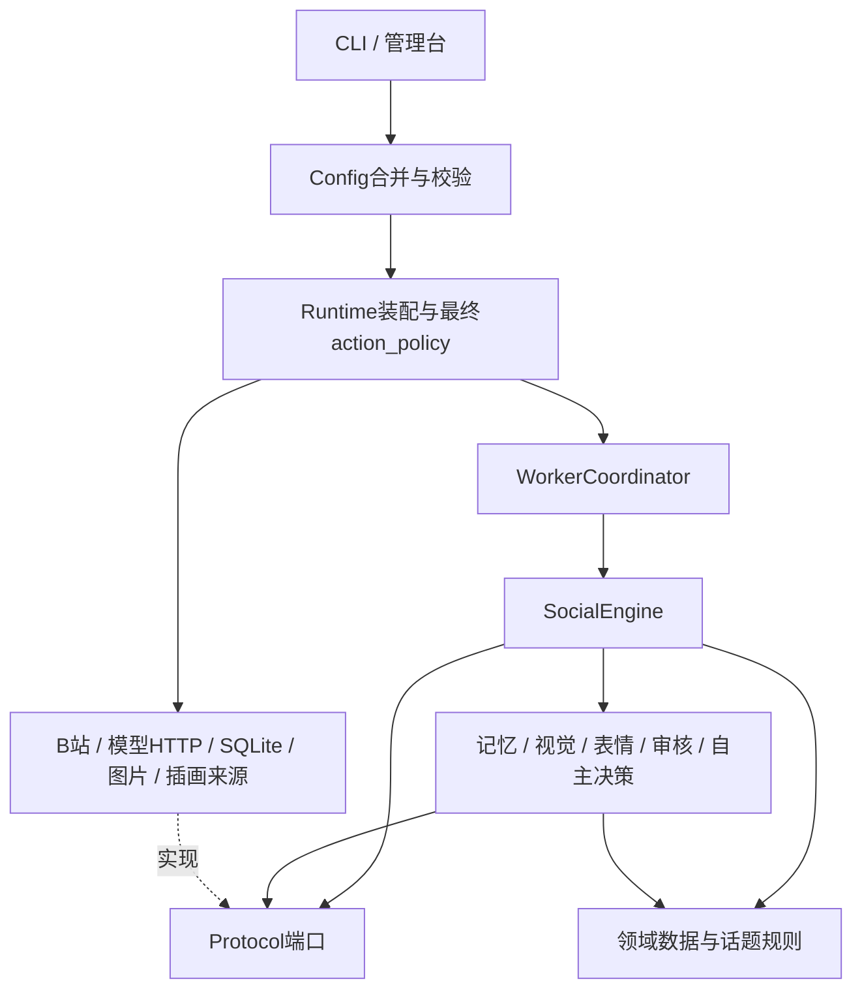

# 当前架构

实现核对日期：2026-10-30；已完成Q0平台解耦及Q1主人QQ文字/图片私聊代码，Q1使用独立OneBot HTTP适配器、签名事件接收器、持久chat_inbox缓冲，复用MemoryService/VisionService及outbox。QQ网关尚未安装，QQ保持关闭，未实号验收。微信、X发布和视频投稿未接入。早期多级目录图是目标设计，实际结构见[平台模块说明](PLATFORM_MODULES.md)与[QQ私聊](QQ_PRIVATE_CHAT.md)。

## QQ接入与模块化方向（2026-10-30，Q0已编码）

开发主线转向QQ。采用现有`src/murasamebot`包内的模块化单体，共享角色、身份、记忆、任务、模型预算和outbox；QQ/B站协议实现及装配分别放在`adapters/platforms/qq/`、`adapters/platforms/bilibili/`与`bootstrap/platforms/`，按阶段迁移，不另建复制内核的`src/MurasameQQ`应用，不引入应用微服务。协议桥可独立运行，但不拥有另一套角色决策循环。

当前已新增`bootstrap/platforms/__init__.py`与`bilibili.py`，独立B站构造、轮询及专属策略；Runtime按启用工厂装配共享内核和端口表，按平台/账号过滤事件、审核及发送领取。禁用B站不创建其客户端、观察与插画来源；假QQ-only模块已用于隔离测试。`Runtime.platform`与旧构造方式保留兼容，真实QQ未接入。内容来源/结果渠道任务拆分仍待Q2，主内容平台配置和部分B站默认值/校验继续保留。

为保护B站实现，本轮不移动`adapters/platforms/bilibili*.py`，也不改其协议代码。功能与完整目标目录见[QQ方案](QQ_INTEGRATION.md)，当前实现见[平台模块说明](PLATFORM_MODULES.md)，决策见D30/D31。下文原有B站业务流程继续有效。

## 技术栈与运行方式

2026-10-30 Q2新增：`application/task_routing.py`通过程序规则选择受绑定约束的投递渠道；`task_routes`附加表与原tasks事务关联，分别保存内容来源与投递账号/模式。QQ结果使用`task_result`进入同一outbox，B站提及使用原recommendation；取消和新QQ输入等待在领取及最终写入前检查。独立公开审核不接收私人委托原文。旧任务不重放；实际QQ仍关闭。详见[QQ/B站任务](QQ_BILIBILI_TASKS.md)。

| 层面 | 当前选择 | 代码依据 |
| --- | --- | --- |
| 语言/包 | Python ≥3.12，setuptools，版本0.1.0 | `pyproject.toml` |
| HTTP | HTTPX+socksio，独立客户端、可选择GFWList分流 | `adapters/network.py`、`proxy_rules.py` |
| 配置 | PyYAML；配置模板、本地覆盖、环境变量 | `bootstrap/config.py` |
| 状态 | 标准库SQLite，WAL、事务、租约、水位、去重 | `adapters/persistence/` |
| 模型 | Chat Completions兼容HTTP接口，JSON输出，共享并发/日额度 | `adapters/models/` |
| 图片/扫码 | Pillow；qrcode为可选login依赖 | `pyproject.toml`、`bilibili_history.py` |
| 管理台 | 标准库ThreadingHTTPServer，原生HTML/CSS/JS，无前端构建服务 | `bootstrap/web.py`及静态资源 |
| 验证 | pytest；可选Node/Edge本机浏览器预览 | `scripts/run_tests.py`、`preview_dashboard.py` |

不需要Redis、MySQL、向量服务、DSH或LingChat进程才能运行。完整Docker部署尚未提供。

## 实际目录

```text
run.py / src/murasamebot/__main__.py  命令入口
src/murasamebot/
  domain/       models.py统一数据对象；topics.py公开话题规则
  ports/        模型、状态、内容、投递、关系及观察来源等Protocol
  application/  engine.py统一社交流程
                memory.py、autonomy.py、owner_history.py
                vision.py、expressions.py、review.py
                scheduling.py、artwork.py、publication.py
                settings.py、request_policy.py
  adapters/     characters/、models/、persistence/、platforms/
                artwork/、media/、network.py、proxy_rules.py
                request_monitor.py；demo.py仅离线模拟
  bootstrap/    config.py装配配置；runtime.py装配实现和最终策略
                platforms/惰性工厂、B站装配/轮询/专属策略
                workers.py协调工作；cli.py、web.py
                dashboard.html/css、owner-history.js、request-controls.js
character/      settings.yml原来源；text_profile.yml文字人设；界面素材
examples/       统一事件输入示例，不是微信真实连接器
tests/          核心流程、边界、协议模拟、配置、管理台等回归
scripts/        隔离测试与本机浏览器预览
docs/           版本化的开发记忆
```

`.env`、`config.local.yml`、`.secrets/`、`data/`、日志、数据库、测试临时目录不入库。

## 依赖与装配



核心层不导入HTTPX、SQLite实现或平台SDK。平台ID与协议留在适配器。不同平台通过统一事件、身份、任务、outbox协作，不彼此直接调用。同平台B站mixins和协议辅助模块共同组成一个适配器。当前有B站首发所需的装配及默认值，并不意味着所有未来平台扩展已抽象完成。

## 主要调用链

### 收件、回复与发送

1. `cli.worker_loop`周期装配Runtime并调用`poll`、`poll_private`，通过数据库水位和唯一事件ID收件。首轮建立基线。
2. 公开通知转成`Event`；私信还需确认互关。`WorkerCoordinator`让独立会话并发生成，同一人的相关私聊保持顺序。
3. `SocialEngine`解析真实人物绑定，读取内容/父链，组合允许范围的记忆，调用模型生成正文、表情、发布判断及公开话题分类。
4. `reviewed + inline`通过则入队，判断不通过转人工；`independent`另做审核。话题禁令与权限不由人工审核放开。
5. `SQLiteStore.claim_action`事务领取，检查额度、时间、来源、任务/记忆版本等。实际写入串行。
6. Runtime最终策略、Engine发送前校验及适配器再次核对身份/互关/来源。保留Receipt；unknown不自动重发。

公开视频读取标题、简介、可得字幕，并可通过`bilibili_frames.py`获取播放器预览快照；按分P和时间选帧，通用图片读取器裁出真实像素，`VisionService`用一次多图请求形成有覆盖限制的视觉证据。不下载整段视频；成功字幕与画面组合为`transcript_visual`，失败保留原文字等级。裁图缓存按批次隔离，内容缓存签名包含裁图坐标/时间/分P/配置，旧缓存按需刷新。详见[视频视觉](VIDEO_VISION.md)。相关父链最多3页×20条加一次对话链补查，提供最多12条/6000字，保留AI祖先发言。动态视觉独立下载允许域名的真实图片，记录成功、部分和失败覆盖。

### 自主计划与历史观察

自主动态/主人私信共用现有协调器、模型限额、审核和outbox，`not_before`持久化，不睡眠占住模型线程。模型可以skip。主人历史使用独立扫码凭证、只GET白名单客户端、独立短期观察表；首次基线不触发互动。私有记录仅供验证主人的私信；公开历史推荐仅从操作者允许公开的主题中匹配，不把原观看清单传到公开生成/审核。

历史动作保存`owner_activity_version`授权/用途版本和`owner_activity_sources`观察记录ID；数据指纹仅供推荐决策去重。发送校验不再重算整份近期列表，按引用ID在保留期内核验；进度更新、新记录和近期窗口滚动不影响旧事实。独立审核只取该动作原引用的记录。旧版快照不含来源ID时保持拦截，要求重新生成。

管理台`POST /api/actions/send`只收已有消息ID，调用`SocialEngine.queue_manual_send`。本地策略检查后，SQLite事务将draft/确定failed的同一动作重新queued，更新投递时间、人工标记和次数；此前回执写入`manual_send`审计。工作循环继续执行既有串行发送与最终检查，管理HTTP请求本身不触发平台写入。

### 请求控制

视频推荐/互动策略新增通用`application/recommendation_policy.py`，只比较Document的view_count/comment_count与配置值；B站适配器负责从view.stat.view/reply映射。配置装配、模型行为提示与程序硬检查分离，Runtime使用最新配置复查待发消息；仅真实视频直接@事件可豁免统计要求。旧JSON缺字段仍可读取，内容服务按需刷新缺统计的视频缓存。详见D38及操作说明。

2026-10-30视频快照兼容：`VideoShotReader`在BV响应无有效帧时，先尝试同响应的`pvdata`大端uint16时间表，再按AV+cid查询，最后仅首P尝试`/pvideo`；二进制读取使用独立无Cookie、无认证头、限制域名/重定向/大小的客户端。所有API兼容请求继续走原共享请求控制；认证/限流立即中止回退。详见D37与视频视觉专题。

`RequestMonitor`/`MonitoredTransport`包装B站API客户端，AI与主人角色共享GET时间槽，角色/通道冷却隔离。日志仅端点元数据。`-509`/HTTP429读取失败使用退避，尚未写出的动作通过`retry_at`等候，不改原`not_before`和有效期；认证/验证码/写入风险仍有平台暂停。计划前静默停止后台采集，私信最后定向预检可越过静默但不能越过实际冷却。

视频点赞/投币在最终门禁前补查缺失的真实网页设备字段，使用凭证同目录的独立`.device.json`缓存，按登录会话摘要跨发送任务复用，不覆写扫码文件；请求携带对应视频来源。模型适配器通过`structured_json.py`严格解析对象，只有视觉描述允许有限尾逗号/原始控制字符规范化；重复键与非有限常量拒绝。视觉服务分开记录图片下载与有效识别，失败不形成视觉证据，详见D32和排障专题。

### 记忆与数据状态

SQLite保存`bindings`、`events`、`tasks`、`actions`、内容缓存、浏览记录、额度、租约和审计。`SQLiteMemory`增加真实对话原文、来源关联、摘要/事实/日记、覆盖与维护状态；`owner_history`为短期观察；`platform_requests`为脱敏诊断。现有schema v1迁移至v2并先生成备份，观察/请求表是后续初始化的附加表，不代表已建立通用迁移框架。

观察日记由`MemoryService`在对话维护暂时无批次时调用，仍持有相同维护租约、共享模型并发和两层额度。`OwnerHistoryService`提供已授权、基线后新增、回顾截止时间内且未覆盖的观察；`observation_diary`模型操作只写中文感想。当前配置和来源在返回后复验，SQLite事务核验授权/绑定/记忆版本及来源，存为`memory_products(kind=diary, scope=observation:<平台>, purpose=owner_observation_diary)`；新增`observation_diary_sources`仅维护独立来源和覆盖，不伪造聊天归档。来源清除/撤权/过期会使正文失效并清除；这些产物不进入普通聊天检索或公开提示词。

管理台新增独立`diary`、`reflections`、`owner-history`页面；`/api/memory/journals`按记忆、日记、相处回顾各自限量查询有效产物，避免一个板块挤占另一个的限额。观看历史授权、设置与记录仅放在“主人足迹”，源权限无效时不展示观察日记。来源弹窗位于页面外层，可在任意记忆板块使用。

持久化范围通常包含agent/person/conversation/visibility/purpose。记忆派生物与任务状态分开；只有平台受理的AI输出算已说过的话。派生物ID包含已核验的memory_epoch，重建即使同文也创建新有效版本，旧失效记录保持原状。普通视频判断在读偏好前捕获epoch；同次推荐/评论/接话/点赞投币继承版本，生成后、入队及最终写入前复验，旧版缺版本的主动动作拒绝投递。当前使用agent级全局版本，失效传播较保守；问题与修复边界见[开发日志](DEVELOPMENT_LOG.md)。

### 社交线索与短期角色状态

`SocialEngine`把程序筛选的`social_context`提供给原回复调用，同次可返回`social_update`。`SocialService`校验精确来源摘录、身份、可见性和可选澄清ID；`SQLiteSocial`在`social_events/role_states`中保存归因与短期反应，独立于事实/偏好/日记。动态正文/相关父评论、真实视觉和授权观看可作来源；观看依赖沿用原授权/记录ID，第三方私聊保持同人同会话隔离。

`AutonomyService`在原后台通道选择到期角色状态，决定私信/动态或skip，保存原Action中的`social_refs/social_followups/social_version`，不新增轮询或发送器。公开来源可提供摘录，主人私人来源只提供感受标签和限制；独立审核也不接收原私密来源。源、状态及配置在生成后/入队/领取/最终写入前核验；平台受理才增加累计提起次数。管理台独立“心情与线索”页面通过鉴权`/api/social`及仅结束/遗忘的`/api/social/manage`管理，操作不直接发平台消息。详见[社交状态](SOCIAL_STATES.md)。

QQ私人渠道策略由模块装配到共享内核（多语言/关闭公开话题筛选），私有视频读取通过`PrivateVideoProvider`包装同一B站协议适配器；公开入口默认仍筛选话题。任务路由决定使用哪个入口，QQ适配器不直接调用B站适配器，绑定/记忆/审核/outbox仍共用。

### 平台管理台与共同模块（2026-10-30）

管理台导航和浏览器代码按QQ/B站分开（`qq-console.js`、`bilibili-console.js`）；`console-common.js`与`shared-memory.js`服务共同设置、记忆/日记/相处回顾。`bootstrap/console.py`与SQLiteConsole提供鉴权后的有界平台投影，不启动模型/发送循环。任务按来源归属，动作按实际投递平台可核查。

共同记录仍使用原MemoryService维护；feed按原文平台关联筛选后限量。跨平台受理输出以实际投递平台/可见性入档并保留源事件关联；同平台旧路径不变。日记/回顾不是各平台独立循环，共同设置中的查找时段与预算仍按原执行语义供两端使用。详见[管理台模块](DASHBOARD_MODULES.md)。
