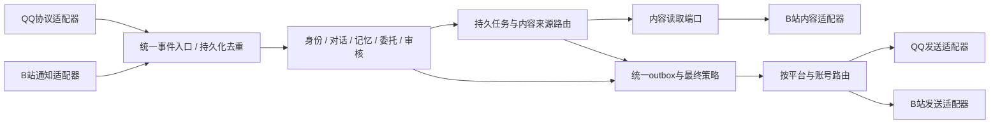

# QQ 丛雨功能范围与模块解耦方案

日期：2026-10-30。状态：功能方案及阶段计划；随后按用户要求完成Q0平台装配与路由隔离编码，实际结构见[平台模块说明](PLATFORM_MODULES.md)。QQ真实连接器尚未实现，完整目标目录未迁移。具体QQ协议尚待核验。

## 1. 目标与当前事实

QQ作为日常相处与委托入口，B站作为内容发现与公开互动渠道；延续同一个agent的人设、已验证人物身份及按用途授权的记忆。共享身份不代表私聊、群聊与公开内容可以任意互相引用。

当前已有：Python分层、统一Event/Action、SQLite、身份绑定、角色、记忆、委托、审核、outbox、模型限额、主动计划和社交状态。实际接入只有B站，QQ/微信只有通用事件与模拟链。上述基础仍需改造，不能把增加一个QQ文件等同于完成多平台支持。

最初一轮仅整理文档；随后Q0新增模块工厂、平台开关、B站独立装配/轮询/策略、平台与账号领取过滤及兼容入口，保持B站协议文件原位不改。未修改本地凭证、正式数据库或角色素材，也不进行真实账号收发。当前实现及验证边界见[STATUS.md](STATUS.md)与[验证记录](VALIDATION.md)。

## 2. 功能范围

| 能力 | 预期行为 | 实施边界 |
| --- | --- | --- |
| 文字私聊 | 中文角色交流、上下文延续、引用回复；连续短消息可合并理解，忙碌/晚安时结束话题 | 先验证一对一收发，再增加短消息合并；合并窗口可配置，原事件仍独立留存 |
| 记忆 | 记住有来源的偏好、近况、约定；支持记住、更正、遗忘 | 复用现有权限过滤与来源失效；不同群、他人私聊继续隔离；不是复制全部B站历史 |
| 委托与结果反馈 | QQ提出需求，保存时间、条件、结果渠道；修改、取消、查询进度；完成后返回结果 | 优先打通找B站视频；普通提醒和周期提醒是新增任务类型，不能宣称已有 |
| 主动联系 | 找到内容、到期提醒、延续话题或适时问候；可选择不说 | 安静时段、冷却、每日限额、过期、暂停；新消息使旧开场失效；不连续催回应 |
| 群内被动接话 | 被@、被引用或明确叫到时，结合上下文回答 | 群启用名单、成员身份、说话对象和引用链；群内普通消息不获得主人权限 |
| 群内自主参与 | 在允许的群里少量参与相关话题，可以旁观 | 后续独立开关与验收，避免逐条调用模型；防止机器人之间循环接话 |
| 链接和图片理解 | 复用B站内容读取；理解实际接收的截图/图片，说明缺失依据 | 媒体下载、大小/数量/域名/协议校验；引用内容与用户指令分离；截图不证明身份 |
| 角色反应 | 有依据的好奇、开心、在意及轻微吃醋；解释后澄清和结束 | 复用短期社交状态；不当作永久事实，不反复追问；私人来源公开投影沿用原规则 |
| 管理 | 主人可暂停主动消息、设置群参与方式、查询/取消委托、管理记忆 | 由程序识别授权身份及校验参数；自然语言不能绕过发送与隐私限制 |
| 后续语音与空间 | 可选语音识别/日语语音输出，QQ空间独立设计 | 全部文字仍中文；不纳入首版；聊天接口可用不证明空间接口可用 |

本地角色表情图、自动头像继续暂缓，头像由用户手动设置。原生表情只使用确认支持的表达；颜文字沿用既有总量约束。授权第三方插画分享沿用独立来源与转载规则。

## 3. 架构选择

采用**模块化单体：一个Python项目、一个应用进程、一套共享内核、按平台隔离适配与装配**。沿用`src/murasamebot`包，不建立复制业务逻辑的`src/MurasameQQ`应用。

| 选项 | 本期选择 | 判断 |
| --- | --- | --- |
| 在现有包内建立QQ/B站模块 | 采用 | 可以独立禁用平台、替换协议，并复用内核；改造可逐步验收 |
| `src/MurasameQQ`作为第二个完整应用 | 不采用 | 目录本身不提供解耦；若复制记忆、调度和发送逻辑，会出现双重决策与状态分叉 |
| 多个独立发行包 | 暂不采用 | 可在接口稳定、确有独立发布需求后，再提取共享内核与平台插件包 |
| 应用微服务化 | 暂不采用 | 当前没有独立扩容或团队独立发布要求；会新增网络契约、分布式幂等、事务及运维成本 |
| QQ协议桥独立进程 | 允许，取决于接入路线 | 协议桥只做登录与协议收发；应用中的角色决策、记忆、任务和outbox仍只有一套 |

如果以后协议依赖冲突、故障隔离或部署要求确需独立进程，可先抽离无业务状态的协议网关。再考虑服务拆分时，应先定义事件版本、鉴权、幂等、回执、重连补偿及状态所有权；不同服务不得直接共享写入同一SQLite文件。

## 4. 目标目录与职责

以下为目标结构，不表示这些文件现在存在。保持现有分层，按迁移阶段拆分，不为占位批量创建空模块。

```text
src/murasamebot/
  domain/                       # 统一事件、动作、任务、目标和能力类型
  ports/                        # 事件输入、投递、内容、权限等Protocol
  application/
    conversation/               # 对话流程、短消息合并、上下文与参与判断
    tasks/                      # 意图、持久委托、执行和投递路由
    ...                         # 既有记忆/审核/视觉/心情/调度，逐步整理
  adapters/
    platforms/
      bilibili/                 # 现有bilibili*.py按阶段迁入
        adapter.py              # B站协议与端口实现
        ...                     # 评论、私信、历史、签名、预览帧、表情
      qq/
        adapter.py              # QQ统一适配入口，不持有角色决策循环
        events.py               # 平台事件与消息段规范化
        messages.py             # 文本/@/引用/媒体的渲染与解析
        access.py               # 该接入路线的收发与群权限检查
        transports/             # 仅实现选定路线；不同时开发所有协议
  bootstrap/
    runtime.py                  # 共享服务与生命周期，按启用模块装配
    platforms/
      bilibili.py               # B站配置、客户端和后台采集装配
      qq.py                     # QQ配置、连接、事件订阅装配
    workers.py                  # 单一业务协调器与统一投递调度
```

平台SDK、OneBot消息段、QQ协议账号标识、WBI/oid/rpid等留在适配器。共享应用可以通过端口读B站视频，但不导入`BilibiliAdapter`或`QQAdapter`。群参与判断、时间规则和任务路由属于应用策略；具体平台是否支持某动作及如何编码，由能力声明和适配器提供。

迁移`bilibili.py`到同名包时必须一次处理文件/包名称冲突、内部相对导入和测试引用；可用包的`__init__.py`保留既有`BilibiliAdapter`导入入口。不同时保留同名模块文件与目录以依赖解释器选择。

## 5. 已确认的耦合点与改造任务（Q0前规划基线）

下表保留规划时的代码问题；Q0已抽离B站装配、轮询和专属策略，增加平台注册、启停及领取路由。内容来源与结果渠道的任务模型仍留到Q2，同平台多账号及分平台主动计划仍待扩展。实际差距与兼容项以[平台模块说明](PLATFORM_MODULES.md)为准。

| 代码位置 | 当前耦合 | 改造方向 |
| --- | --- | --- |
| `bootstrap/runtime.py`的`Runtime.platform`、`build()` | 类型与构造直接绑定`BilibiliAdapter`，构建时读取B站配置 | 共享服务独立装配，平台工厂按启用状态创建；QQ-only不创建B站客户端或要求其凭证 |
| `bootstrap/runtime.py`的`prepare_store()` | 主动配置指纹混入B站私信开关 | 把通用初始化与平台配置初始化分开；指纹、取消范围和自主计划带平台/账号维度 |
| Runtime轮询、`bootstrap/workers.py`和CLI | 通知/私信轮询、插画目标、扫码等使用单个平台对象或B站字面值 | 通用事件入口支持轮询和推送；B站采集/扫码保留于B站模块；CLI/管理台显示平台状态 |
| `application/engine.py`及Settings | 兼有对话、视频探索、推荐、审核和投递；存在单一`settings.platform/account_id` | 先明确每次调用的路由上下文，再逐步拆对话、任务与内容探索用例；不整体复制引擎 |
| `engine.py`任务创建与执行 | 任务目标使用`self.settings.platform`，绑定和provider按单一目标平台处理 | 分离内容来源与结果渠道；明确`content_provider`及`delivery_target`，允许B站找视频、QQ回结果 |
| `engine.py`的`sinks/providers/private_access`与dispatch | 注册表主要以platform索引，outbox由共享领取逻辑派发 | 首版可限制每平台一个机器人账号；注册路由逐步支持`(platform, account_id)`，发送账号必须匹配 |
| 配置、管理台与默认值 | 存在B站通知/私信、互关、分区、浏览与推荐预算 | 通用设置与平台设置分组；保留现有配置兼容路径，不把B站互关规则套用QQ |

这份表记录规划基线与目标，不表示所有目标均已实现。B站原有鉴权、签名、限流、首次基线、互关和可见性处理必须保留。

## 6. 事件、任务和投递边界

目标数据流：



具体约束：

1. 输入保存程序确认的agent、平台、机器人账号、发送者、会话、可见性、事件ID、时间、引用关系和必要消息段；事件唯一键包含平台与账号。不同群/私聊ID不可碰撞。
2. 收件人从真实事件或已授权绑定与路由产生，模型不能自由选择。QQ主人身份需验证绑定，不以昵称、人设称呼或截图证明。
3. 内容来源、任务发起渠道、结果渠道分别记录。对比“找B站视频发QQ”和“到B站@主人”，不能只用一个`target_platform`隐含全部语义。
4. 复用来源失效和任务取消：解绑、更正、遗忘和取消后，关联未发动作失效；重启、重连及人工批准不能复活旧动作。
5. 一个agent只有一个业务决策协调器；收件I/O和必要协议心跳可以独立运行，但不独立生成角色回复。模型调用共享并发与预算。
6. outbox只有一个统一领取/投递协调者，不给QQ和B站各建一个会竞争全局队列的引擎。领取时按目标能力、账号和当前策略检查；禁用平台的动作暂停/取消须有明确状态，不能被另一个平台消费成失败或误发。
7. 沿用现有全局串行写入、默认最小10秒间隔与60秒处理失败重试；这些是项目策略，不是QQ官方限额。QQ-specific节流与冷却叠加执行，调整全局策略需另记决策。明确区分失败、受理、unknown和实际客户端送达；unknown不盲目重发。
8. 能力声明区分文字私聊、主动私聊、群回复、引用、图片、语音和空间；不支持则解释/降级/保留任务，不伪装成功。相同记忆服务仍须先按权限和用途筛选，不把B站观察日记直接注入QQ聊天。
9. 平台暂停、读取退避、连接故障和配置版本按平台/账号隔离；全局暂停与模型预算继续共享。B站不可用时，普通QQ对话仍能工作；依赖B站内容的QQ任务显示等待或失败原因。

## 7. QQ接入路线待核验

尚未选定QQ官方机器人接口或独立QQ协议桥路线。选择前先确认账号形态、单聊/群聊收件范围、主动发送条件、事件唯一性、重连/历史补偿、引用/图片、授权方式和部署成本。空间能力另行核验，不能由聊天协议推断。

如采用NapCat/OneBot，协议桥负责QQ会话与协议，`adapters/platforms/qq/transports/`负责连接与转换；核心不感知具体桥实现。支持推送并不意味着回调到达就已经可靠入库：需先持久化去重再业务处理；遇到补偿不可得时明确展示消息缺口。回调/WS连接需鉴权，桥的WebUI凭证与消息接口凭证分开。

接入时重新核对一手文档与实际账号权限，不把接口文档或本方案视为实号验收：

- [腾讯QQ机器人开发文档源仓库](https://github.com/tencent-connect/bot-docs)
- [NapCat文档源仓库](https://github.com/NapNeko/NapCatDocs)

## 8. 开发顺序与验收

| 阶段 | 交付 | 必须通过的验收 |
| --- | --- | --- |
| Q0：平台解耦 | 共享装配、平台注册/能力、路由上下文、平台配置隔离；保留B站行为 | B站-only兼容；模拟QQ-only不需要B站配置/凭证/登录或B站网络调用；禁用B站不生成其计划；两个平台同号ID不碰撞；共享发送不会抢错动作 |
| Q1：真实文字私聊 | 选定一个协议、连接诊断、主人绑定、QQ收发、记忆和重启恢复 | 用户授权的测试账号实际收到正确回复；断线/重启/重复事件不重复发；同名冒认无权限；单会话顺序正确；unknown保留保护 |
| Q2：跨平台委托 | 来源/投递目标分离，QQ需求到B站内容检索再QQ反馈，保留B站@投递 | 修改/取消/解绑/遗忘阻断旧任务；两种投递各自正确；QQ-only时缺B站能力给出可诊断状态；私聊原文不进入公开评论 |
| Q3：主动、多媒体与群被动回复 | 主动联系、图片/链接、群内被@与引用回复；新增提醒任务另验收 | 安静时段/新消息失效/额度生效；媒体失败可降级；群/成员隔离；不把群截图当身份或私聊授权 |
| Q4：扩展体验 | 群自主参与、语音、空间分别评估与实现 | 每项独立开关、协议能力确认、故障降级与实号验收 |

每次先完成最小必要拆分，再引入相应功能，避免同时迁移目录、重写调度和接入真实账号。结构重构需验证B站签名/私信权限/发送回执/审核/记忆失效等既有边界；QQ新增逻辑以协议模拟和隔离数据库验证。架构约束检查应覆盖核心无平台SDK导入、平台适配器不互相导入、未启用平台不初始化。

真实读写仅在用户授权的验收流程中进行，开发测试不发布社交内容；模拟测试通过、平台受理、用户确认收到分别记录。现有维护饥饿与备份恢复待办继续保留，不要求QQ接入前先完成整个Docker/多平台路线图。

## 9. 本次交付与下一步

最初交付为功能与架构方案，随后已编码Q0并进行B站回归和假QQ模块验证。下一步核验接入路线进入Q1；尚无真实QQ连接器。未新增空的`MurasameQQ`包，未引入微服务、独立消息队列或第二套角色内核。适配器目录暂不搬迁，以保留B站导入和协议行为。
